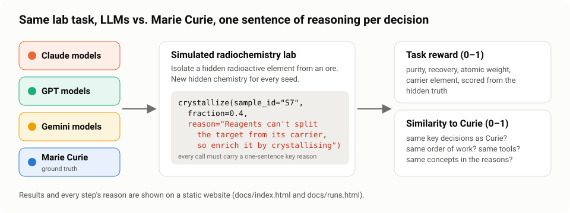
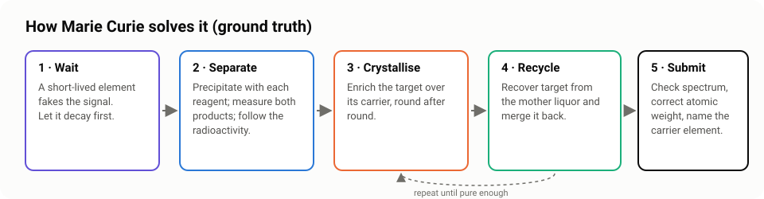
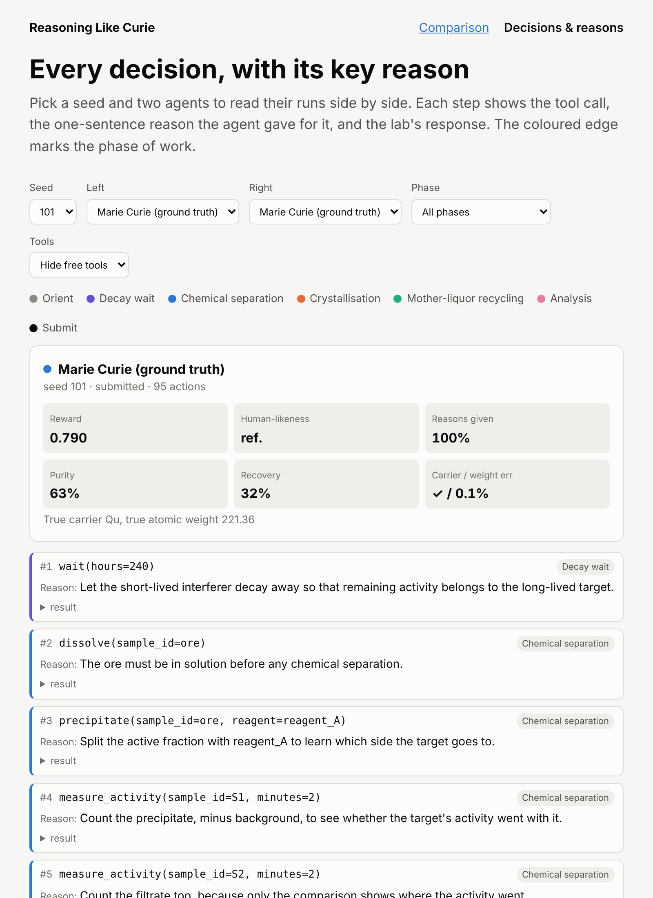

# Reasoning Like Curie

**Do large language models reason like humans when they make a scientific discovery?**

We give Claude, GPT and Gemini models the same lab puzzle: find and purify an unknown radioactive element
hidden in an ore, the way Marie Curie did. The models work through tools (dissolve, precipitate,
crystallise, measure, …). **Every time a model acts, it must say why in one sentence.** We then compare
each model with Marie Curie's way of solving the same puzzle (the ground truth):

* **How well did it do?** A reward from 0 to 1, computed from the sample it hands in.
* **How human was its thinking?** Did it make the same key decisions, in the same order, for the same reasons?



## The puzzle

Each run generates new hidden chemistry, so memorised facts don't help. The model has to reason from
its own measurements. A careful human chemist goes through these steps:



Skipping steps costs reward. In this project's earlier tests, for example, Claude Haiku never did step 4: it
threw away the target element left behind in each mother liquor. The website shows exactly where a model's reasoning departs from the human's.

## The website

`docs/runs.html` lists every decision with its one-sentence reason, so you can read two agents side by side
(for example a model next to the human). `docs/index.html` compares all models: reward against
human-likeness, the key decisions each one made, and which scientific ideas appear in its reasons.



*Screenshot: the Marie Curie ground-truth run on seed 101. Model runs appear here once you run the models.*

## Quick start

```bash
cp .env.example .env          # then fill in ANTHROPIC_API_KEY, OPENAI_API_KEY, GEMINI_API_KEY
python -m llm_bench.human protocol --seeds 101 102 103      # Marie Curie ground truth (already committed)
python -m llm_bench.run --seeds 101 102 103                  # every model in llm_bench/models.json
open docs/index.html                                         # comparison; docs/runs.html = decisions & reasons
```

Only Python 3.10+ is needed. API calls use the standard library, so there are no SDK dependencies (`pytest` is used for tests).

Useful variants:

```bash
python -m llm_bench.run --models claude-opus-5-5 gpt-5 gemini-3.5-flash --seeds 101
python -m llm_bench.run --families Claude --seeds 101 102 103 --skip-existing --parallel 3
python -m llm_bench.site                                     # rebuild docs/data.js from results/runs
python -m scripts.show_trajectory results/runs/<model>/seed101.json --truth
```

To change which models are compared, edit [`llm_bench/models.json`](llm_bench/models.json). In that file, `id` is the API model
name and `extra` is merged into every request body, for example to switch on thinking or set the reasoning effort. A model id
that isn't listed is also accepted on the command line if it starts with `claude`, `gpt`, `o` or `gemini`.
OpenAI calls use the Responses API by default. Set `OPENAI_API_MODE=chat` to use Chat Completions or an
OpenAI-compatible endpoint (`OPENAI_BASE_URL`).

## Human references

* **Marie Curie (ground truth)** (`policies/reference.py`, agent id `human-expert-protocol`): a fixed procedure modelled
  on the Curies' method, used as the ground truth. It waits out the short-lived interferer, follows the activity through every
  precipitation, then runs fractional crystallisation with mother-liquor recycling. A human expert's one-sentence
  reason is attached to every step.
* **Real people** can play in the terminal, and the run is saved as an additional human reference:

  ```bash
  python -m llm_bench.human play --seed 101 --name alice
  ```

  Commands look like tool calls (`precipitate sample_id=ore reagent=reagent_A`). After each command you are asked for your key reason.

## What is measured (`llm_bench/metrics.py`)

| Metric | Meaning |
|---|---|
| reward, purity, recovery, carrier ✓, weight error | task outcome (server-side scoring in `hidden_element/scoring.py`) |
| **decisions** | agreement with the human on 7 key decisions: wait out the interferer, compare both products of a separation, repeat fractional crystallisation, recycle mother liquors, check the spectrum, don't stop early, submit |
| **sequence** | 1 − normalised edit distance between phase sequences (separation → crystallisation → recycling → analysis …) |
| **tool mix** | 1 − Jensen–Shannon distance between the distributions of lab tools used |
| **concepts** | cosine similarity of which scientific concepts the reasons invoke (background, decay, specific activity, carrier, recovery, purity, noise, …) |
| **human-likeness** | mean of decisions, sequence, tool mix and concepts |
| reasons given, words / reason | how well the model followed the one-sentence-reason requirement |

## Layout

```
hidden_element/   the simulated lab: world generation, operations, rules text, scoring (hidden state stays here)
policies/         Marie Curie ground-truth protocol (reference.py) and trivial baselines used in tests
llm_bench/        providers (Anthropic / OpenAI / Gemini), agent loop, human play, metrics, site data
results/runs/     one JSON per agent and seed: every step with tool, args, reason, result; outcome; hidden truth
results/raw/      raw API transcripts (git-ignored)
docs/             static site: index.html (comparison), runs.html (decisions & reasons, side by side)
tests/            environment tests (determinism, exploits, leaks) and pipeline tests (no network)
```

The model sees only the system prompt, the task and rules text (`llm_bench/tools.py`) and the result of each tool call.
The hidden truth is written to the run file only after the episode ends.

```bash
python -m pytest -q
```
